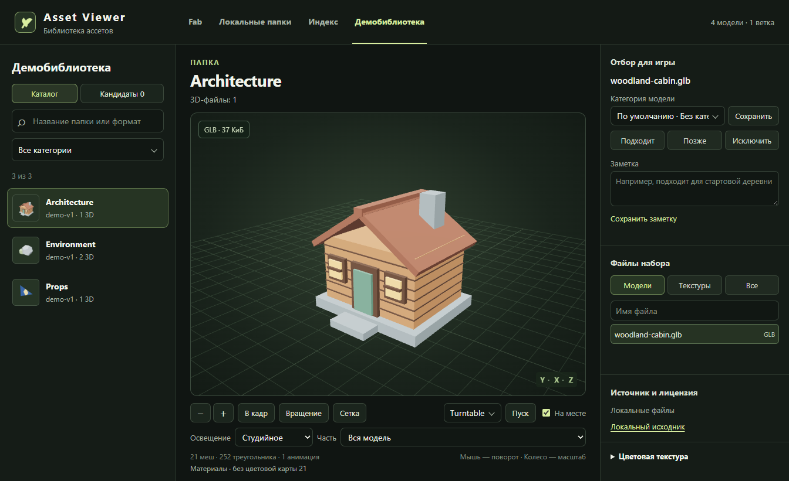

# Asset Viewer

**Asset Viewer — the first desktop application of the AI-Native Game Asset Management System.** It previews 3D models and textures, connects local game asset folders, and builds a searchable SQLite index. The web and desktop versions work with local data and require no AI account or cloud service.

[Русский README](README.ru.md) · [User guide](docs/USER_GUIDE.md) · [Development status](docs/STATUS.md)



## Run from source

Use Node.js 22.16 or later.

```sh
npm ci
npm start
```

Open [Asset Viewer](http://127.0.0.1:8177/). Choose **Демобиблиотека** for the included procedural demo. Choose **Индекс** and enter an absolute folder path to create a persistent library, scan files, and search by name, path, format, or saved metadata. The current viewer interface is in Russian.

Select a connected library and turn on **Следить за папкой** to pick up file changes automatically while Asset Viewer is open.
Open **Технический анализ** in an indexed file's details to inspect supported model metrics and their texture or buffer dependencies.
Use **Проверка по профилю** to compare those measurements with editable project budgets.

Use `npm run desktop` for the Electron app. Use `npm run build:windows` to create a Windows x64 installer and portable executable with bundled Node.js. See [BUILD.md](docs/BUILD.md).

## Capabilities

- Interactive 3D review, wireframe, lighting, parts, animation controls, thumbnails and texture overrides.
- Direct browsing of local folders and optional local Fab catalogs with their existing review and classification settings.
- Persistent indexing, SHA-256 duplicate detection, incremental scans and version history. Background scans report progress and support cancellation and retry. Search results open in the existing viewer.
- Indexed tags, categories, notes, review decisions and license text.
- JSON CLI commands for asset search, export, scans, backups and diagnostics. A read-only local [MCP server](docs/MCP.md) exposes paginated metadata access.

Blender is optional. The viewer uses it to prepare GLB previews for BLEND, USD and Alembic. See the [user guide](docs/USER_GUIDE.md) for formats and settings.

## Develop

```sh
npm run check
npm test
npm run benchmark
npm run cli -- --help
```

[Architecture](docs/ARCHITECTURE.md) · [API](docs/API.md) · [Security](SECURITY.md) · [Roadmap](docs/ROADMAP.md) · [Contributing](CONTRIBUTING.md)
